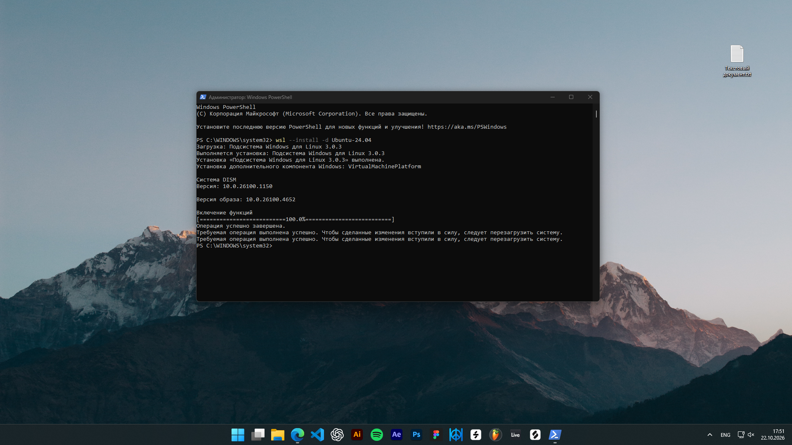
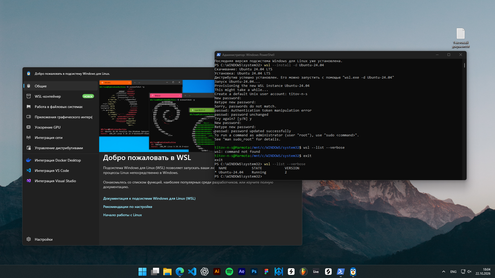
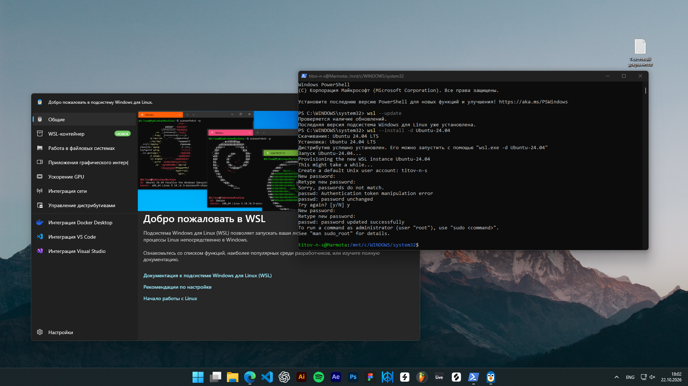
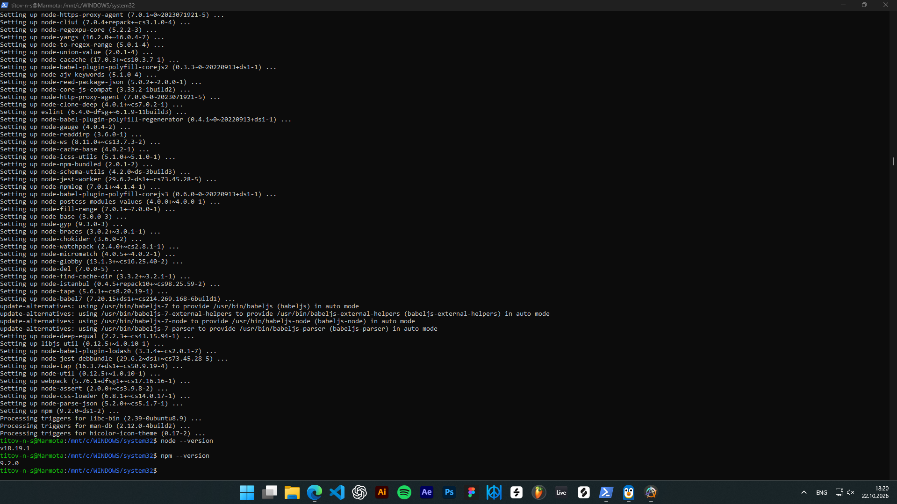
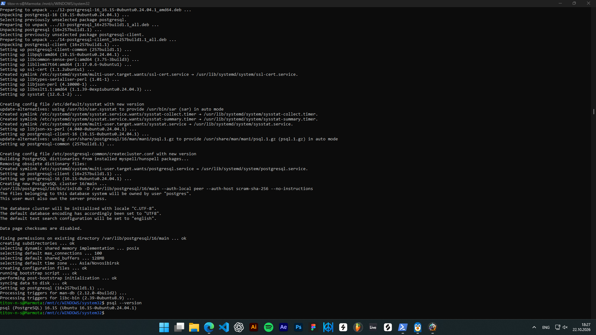

# WSL

## 1. Установка WSL и Ubuntu

Установлена подсистема WSL 2 и операционная система Ubuntu 24.04 LTS.

## 2. Создание пользователя Linux

Создан пользователь Linux с именем `titov-n-s`.

## 3. Обновление пакетов

Обновлены списки пакетов Ubuntu.

## 4. Установка SDK

Установлены инструменты Node.js и npm.

## 5. Установка PostgreSQL

Установлена PostgreSQL.

